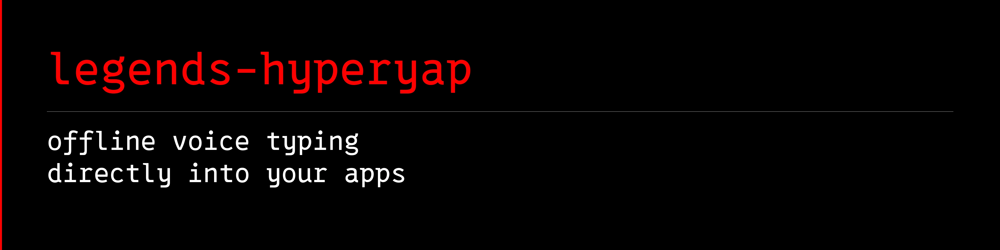

<a name="banner"></a>
<a name="legends-hyperyap"></a>
<a name="hyperyap"></a>

# 

[](https://github.com/avalonreset/legends-hyperyap/releases/latest)
[](https://github.com/avalonreset/legends-hyperyap/actions/workflows/ci.yaml)
[](LICENSE)

speak. it types. transcription stays local.

local voice-to-text for windows, macos, and linux. nvidia parakeet runs on your computer and pastes into the app you already have focused. shortcuts, a custom dictionary, and formatting rules turn dictation into an everyday typing workflow.

core transcription works offline after the model download. optional remote LLM
processing sends text to the endpoint you configure; keep it disabled for an
entirely local dictation workflow.

[download](https://github.com/avalonreset/legends-hyperyap/releases/latest) ·
[first dictation](docs/FIRST-RUN.md) · [troubleshooting](docs/FIRST-RUN.md#troubleshooting) ·
[local API](docs/API_USAGE.md)

v0.1.3 prefers cuda on windows when a compatible gpu is present, then falls back to cpu. the public desktop application runs standalone. on a legends desk, the same engine can live as a module inside legends bridge. bridge is not required.

## Agent setup (via `cto-legends`)

Part of the [CTO Legends](https://github.com/avalonreset/cto-legends) ecosystem. `cto-legends` is the only registered skill; this repo vendors a pinned copy at [`skills/cto-legends/SKILL.md`](skills/cto-legends/SKILL.md).

Install with `cto-legends install legends-hyperyap`, then follow the module recipe the router loads ([`docs/AGENT-RECIPE.md`](docs/AGENT-RECIPE.md)). Do not register this module as its own skill.

## Table of Contents

- [What You Get](#what-you-get)
- [Why This Model](#why-this-model)
- [Install](#install)
- [Shortcut Support](#shortcut-support)
- [Terminal-Friendly Workflows](#terminal-friendly-workflows)
- [Platform Compatibility](#platform-compatibility)
- [Requirements](#requirements)
- [How It Works](#how-it-works)
- [Configuration](#configuration)
- [Build from Source](#build-from-source)
- [Contributing](#contributing)
- [Attribution](#attribution)
- [License](#license)

## What You Get

One app for private, local transcription:

- **Local speech-to-text** powered by the English NVIDIA [Parakeet TDT 0.6B v2](https://huggingface.co/nvidia/parakeet-tdt-0.6b-v2) model through the [smcleod INT8 ONNX conversion](https://huggingface.co/smcleod/parakeet-tdt-0.6b-v2-int8). No cloud, no internet after first install.
- **Fast record-and-paste workflow** that transcribes speech and inserts the result into the active app.
- **Configurable shortcuts** for recording, last transcript paste, command mode, cancellation, and LLM-assisted modes.
- **Toggle-to-talk and push-to-talk** recording modes.
- **Optional LLM post-processing** through local Ollama or a configured remote endpoint.
- **Custom dictionary and formatting rules** for names, commands, casing, and recurring phrases.
- **Import/export settings** for moving configurations between installs.
- **Desktop builds** for Windows, macOS Apple Silicon, macOS Intel, and Linux x86_64.

## Why This Model

legends-hyperyap is optimized for English-first local dictation. The default model is NVIDIA's [Parakeet TDT 0.6B v2](https://huggingface.co/nvidia/parakeet-tdt-0.6b-v2), packaged through the [smcleod/parakeet-tdt-0.6b-v2-int8](https://huggingface.co/smcleod/parakeet-tdt-0.6b-v2-int8) ONNX INT8 conversion.

That choice is deliberate. legends-hyperyap is built around fast, private, everyday English speech-to-text rather than broad multilingual coverage. The v2 Parakeet line is English-focused, the ONNX INT8 conversion fits the local desktop runtime, and the model can run fully offline after the first download. For users whose main need is English dictation into editors, terminals, chat apps, and coding tools, this keeps the app focused on the workflow it is meant to serve.

Multilingual Parakeet models are still valuable for multilingual transcription, but they are not the default direction for legends-hyperyap right now. The project prioritizes English quality, local reliability, low-friction installation, and a fast record-and-paste loop.

## Install

`v0.1.3` is published as a source release. Build and package the native desktop installer for your platform using the guided source build below, or download prebuilt packages when attached to a GitHub Release.

### Windows (Guided Source Build)

1. Install [Node.js LTS](https://nodejs.org/), `pnpm`, and the [Rust toolchain](https://rustup.rs/).
2. Clone the repository and fetch the Parakeet ONNX model and dependencies:
   ```bash
   git clone https://github.com/avalonreset/legends-hyperyap.git
   cd legends-hyperyap
   bash .github/scripts/download-parakeet-model.sh resources
   pnpm install
   ```
3. Build the native Windows hotkey helper (`hyperyap-hotkeys.exe`) and Tauri installer:
   ```bash
   cargo build --release --manifest-path hotkeys/Cargo.toml
   pnpm tauri build
   ```

### macOS

Build from source with `pnpm tauri build` or install the matching DMG when attached to a [GitHub Release](https://github.com/avalonreset/legends-hyperyap/releases/latest):

- `HyperYap_aarch64_darwin.dmg` for Apple Silicon Macs
- `HyperYap_x86_64_darwin.dmg` for Intel Macs

macOS requires Accessibility permission for global shortcuts.

### Linux

Build from source with `pnpm tauri build` or install `HyperYap_amd64.AppImage` / `HyperYap_amd64.deb` when attached to a [GitHub Release](https://github.com/avalonreset/legends-hyperyap/releases/latest).

### Upgrading

Run the newly built installer over an existing install. legends-hyperyap upgrades in place without deleting your speech model or requiring a re-download.

## Shortcut Support

legends-hyperyap records through configurable shortcuts. The exact binding can be changed from Settings.

| Shortcut | Action |
|----------|--------|
| Record shortcut | Start or stop recording |
| `Ctrl+Shift+Space` | Paste last transcript |
| `Ctrl+Alt+Space` | LLM-assisted recording |
| `Ctrl+Shift+X` | Command mode |
| `Ctrl+Shift+1` through `Ctrl+Shift+4` | LLM mode slots |
| `Escape` | Cancel recording |

The Windows workstation preset maps `F13`, `CapsLock`, and Mouse Back to the record shortcut, and maps Mouse Forward to Enter. Those mappings come from the optional hotkey helper and can be paused from its tray menu.

## Terminal-Friendly Workflows

legends-hyperyap can be used with any app that accepts pasted text. It is especially useful in editors, chat apps, terminals, issue trackers, and coding tools where fast dictation reduces context switching.

The optional hotkey helper adds terminal-aware behavior where supported:

- Smart copy, paste, and undo handling for terminal windows.
- Clipboard screenshot conversion into a saved PNG path before paste.
- Bounded paste undo for recent legends-hyperyap-managed terminal inserts.

Supported terminal process names for the helper:

| Terminal | Process |
|----------|---------|
| WezTerm | `wezterm-gui.exe` |
| Windows Terminal | `windowsterminal.exe` |
| PowerShell | `powershell.exe` |
| PowerShell 7+ | `pwsh.exe` |
| Command Prompt | `cmd.exe` |
| Alacritty | `alacritty.exe` |
| ConEmu | `conemu.exe` / `conemu64.exe` |
| Hyper | `hyper.exe` |
| Git Bash (mintty) | `mintty.exe` |
| Tabby | `tabby.exe` |
| Warp | `warp.exe` |
| MobaXterm | `mobaxterm.exe` |

## Platform Compatibility

The core app is built for Windows, macOS, and Linux. Global shortcut behavior is implemented separately per platform, so support depends on the operating system permissions and desktop environment.

| Capability | Windows | macOS | Linux |
|------------|---------|-------|-------|
| Local Parakeet transcription | Supported | Supported | Supported |
| Configurable recording shortcuts | Supported | Supported with Accessibility permission | Supported where the desktop/session allows global input hooks |
| Automatic paste into active app | Supported | Supported | Supported |
| CapsLock and mouse side-button remapping | Supported through the optional hotkey helper | Not currently bundled | Not currently bundled |
| Smart terminal copy/paste/undo helper | Supported through the optional hotkey helper | Not currently bundled | Not currently bundled |

In short: the app works as a local voice-to-text tool on macOS and Linux, while the CapsLock remapper and smart terminal helper are Windows-only. macOS users must grant Accessibility permission. Linux global shortcuts may vary by distribution, window manager, and Wayland/X11 session.

## Requirements

- Windows 10+, macOS, or Linux x86_64
- A microphone
- ~700MB disk space for the speech model
- Internet connection for first launch model download
- Optional on Windows x64: an NVIDIA GPU with a compatible CUDA 12 and cuDNN 9 runtime. legends-hyperyap tries CUDA first and falls back to CPU automatically when GPU acceleration is unavailable.

## How It Works

1. Press your configured record shortcut.
2. Speak naturally into your microphone.
3. Press the shortcut again to stop recording.
4. legends-hyperyap transcribes locally using the Parakeet TDT model.
5. The transcription is automatically pasted into the active window.

Speech recognition happens on your machine and works offline after the initial
model download. Optional LLM post-processing is separate: local Ollama keeps
that step local, while a configured remote endpoint receives the text submitted
to it. Model downloads and update checks also require network access.

## Configuration

legends-hyperyap works out of the box with minimal setup. All settings can be changed from the app's Settings page.

| Setting | Default | Description |
|---------|---------|-------------|
| Record mode | Toggle-to-talk | Press once to start, press again to stop. Can be changed to push-to-talk. |
| Record shortcut | Configurable | Remap to any supported key or key combination. |
| Language | English | Optimized for English local dictation. |
| Overlay | Bottom of screen | Recording indicator position. Can be set to top, bottom, or hidden. |
| LLM Connect | Disabled | Post-process transcriptions with a local LLM through Ollama or a configured remote endpoint. |
| HTTP API | Disabled | Local API on localhost for external tool integration. |
| Sound feedback | Enabled | Audio cues when recording starts and stops. |
| Copy to clipboard | Disabled | Optionally keep transcriptions in the clipboard. |

Settings are stored in `%APPDATA%/com.avalonreset.hyperyap/settings.json` on Windows. Each install or upgrade resets settings to the recommended defaults. If you need to preserve custom settings across upgrades, back up this file before updating.

### Hotkey Customization

All in-app shortcuts can be remapped from the Settings page. Platform-level remapping such as CapsLock or mouse side buttons is handled by the optional hotkey helper where available.

## Build from Source

```bash
pnpm install

# Download the default Parakeet ONNX model into resources/parakeet-tdt-0.6b-v2-smcleod-int8/
bash .github/scripts/download-parakeet-model.sh resources

# Build the optional hotkey helper before packaging the Windows installer
cd hotkeys && cargo build --release && cd ..

pnpm tauri dev      # development
pnpm tauri build    # production build
```

Requires: Node.js 18+, Rust, pnpm, [Tauri prerequisites](https://v2.tauri.app/start/prerequisites/).

## FAQ

**Does `legends-hyperyap` send my voice recordings to the cloud?**
No. Speech recognition runs 100% locally on your machine using the NVIDIA Parakeet TDT 0.6B v2 ONNX model and works offline after the initial model download.

**How is `legends-hyperyap` different from `legends-ambient-intelligence`?**
`legends-hyperyap` is for live push-to-talk or toggle-to-talk dictation pasted directly into your active cursor. [`legends-ambient-intelligence`](https://github.com/avalonreset/legends-ambient-intelligence) is for passive background audio and USB voice recorder ingestion into [`legends-empire`](https://github.com/avalonreset/legends-empire).

## Contributing

Contributions are welcome. See [CONTRIBUTING.md](CONTRIBUTING.md) for development setup, PR workflow, and coding guidelines.

Please read the [Code of Conduct](CODE_OF_CONDUCT.md) before contributing.

## Attribution

legends-hyperyap's voice engine is a modified version of [MURmure](https://github.com/Kieirra/murmure) by [Kieirra](https://github.com/Kieirra). Full credit to the original author for building an excellent local speech-to-text application.

Powered by NVIDIA's [Parakeet TDT 0.6B v2](https://huggingface.co/nvidia/parakeet-tdt-0.6b-v2) English speech recognition model, using the [smcleod/parakeet-tdt-0.6b-v2-int8](https://huggingface.co/smcleod/parakeet-tdt-0.6b-v2-int8) ONNX INT8 conversion.

## License

The voice engine is licensed under [AGPL-3.0](LICENSE). See [NOTICE](NOTICE) and [THIRD_PARTY_NOTICES.md](THIRD_PARTY_NOTICES.md) for full attribution details.

---

**Specification & benchmarks on cto-legends.com:**
- **Module specification & architecture matrix:** [cto-legends.com/modules/legends-hyperyap](https://cto-legends.com/modules/legends-hyperyap)
- **Related engineering dispatches:** [Codex vs Claude Code: CLI and Cursor Agent Benchmarks](https://cto-legends.com/blog?post=codex-vs-claude-code-benchmarks) · [How to Build AI Agents: Production CLI & MCP Routing](https://cto-legends.com/blog?post=how-to-build-ai-agents-cli-mcp-routing)
- **Ecosystem hub:** [cto-legends.com/home](https://cto-legends.com/home)
