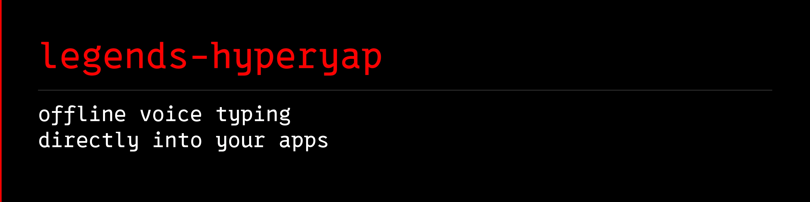
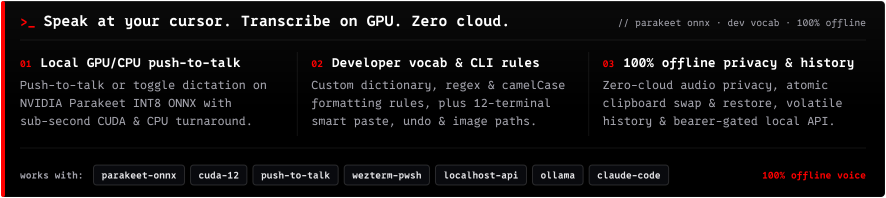
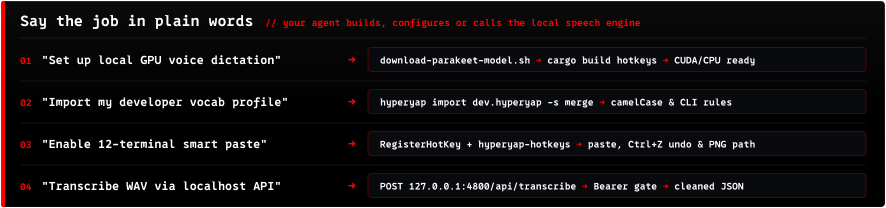
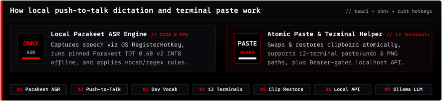
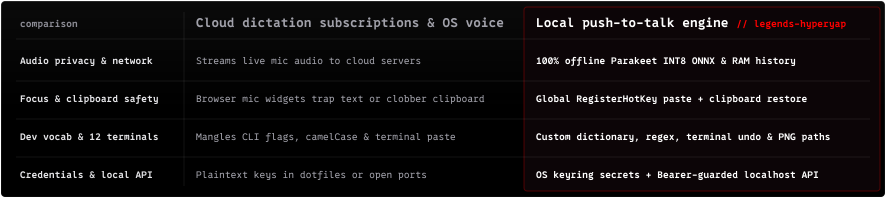

<a name="banner"></a>
<a name="legends-hyperyap"></a>
<a name="hyperyap"></a>

# 

[](https://github.com/avalonreset/legends-hyperyap/releases/latest)
[](https://github.com/avalonreset/legends-hyperyap/actions/workflows/ci.yaml)
[](https://github.com/avalonreset/legends-hyperyap/actions/workflows/contract.yml)
[](src-tauri/Cargo.toml)
[](src-tauri/tauri.conf.json)
[](LICENSE)

**Local push-to-talk GPU and CPU voice dictation for Windows, macOS, and Linux: transcribe speech 100% offline with NVIDIA Parakeet TDT 0.6B v2 INT8 ONNX, apply developer dictionary and camelCase/CLI formatting rules, and paste straight into your active editor or 12 supported terminals with atomic clipboard restoration.**


```text
Install or update legends-hyperyap via cto-legends (https://github.com/avalonreset/cto-legends): run `cto-legends install legends-hyperyap --apply`, then `cto-legends handoff legends-hyperyap` and follow the returned JSON recipe to verify `hyperyap` and `hyperyap-hotkeys`.
```



## Why `legends-hyperyap` exists

Most voice dictation setups break down when you use them inside a software engineering or coding-agent workflow:

1. **Cloud subscription dictation streams live microphone audio off your machine:** Commercial voice-typing subscriptions and browser microphone widgets stream your spoken prompts and private architecture notes to remote servers, retain transcripts in third-party logs, and fail whenever you work offline.
2. **Browser voice widgets break window focus and clobber your clipboard:** Clicking a microphone button inside a web tab forces you to leave your IDE or terminal, wait for output, and copy-paste by hand, or uses a naive paste wrapper that permanently overwrites whatever code snippet you already had on your clipboard.
3. **Generic OS dictation mangles developer vocabulary and terminal shortcuts:** Built-in operating system voice typing turns spoken CLI flags, `camelCase` identifiers, and product names into lowercase prose, and has zero awareness of terminal paste chords (`Ctrl+Shift+V`), single-step dictation undo, or pasting clipboard screenshots as file paths into CLI coding agents.

`legends-hyperyap` is a native desktop voice dictation engine (built with Tauri, Rust, and ONNX Runtime) powered by the pinned [smcleod/parakeet-tdt-0.6b-v2-int8](https://huggingface.co/smcleod/parakeet-tdt-0.6b-v2-int8) conversion of NVIDIA's [Parakeet TDT 0.6B v2](https://huggingface.co/nvidia/parakeet-tdt-0.6b-v2) model. Once the speech model is downloaded, every syllable is transcribed locally on your GPU (CUDA 12 on Windows x64) or CPU with zero cloud telemetry, formatted through your custom technical dictionary, and pasted at your active cursor while preserving your prior clipboard.

## Ask in plain english

Once [`cto-legends`](https://github.com/avalonreset/cto-legends) is installed, you ask your coding agent in plain english. It downloads and verifies the pinned Parakeet ONNX model, compiles or configures the hotkey and terminal helper, imports `.hyperyap` dictionary profiles, or calls the Bearer-authenticated localhost transcription API:



## Architecture: local Parakeet ASR and atomic terminal paste



### 1. 100% offline NVIDIA Parakeet TDT 0.6B v2 INT8 ONNX engine

`legends-hyperyap` is engineered for high-speed English dictation into editors, terminals, issue trackers, and coding agents:

- **CUDA-first GPU acceleration with automatic CPU fallback:** On Windows x64, the ONNX Runtime engine prefers the bundled CUDA 12 / cuDNN 9 execution provider for sub-second GPU turnaround and falls back cleanly to CPU when no dedicated NVIDIA GPU is present.
- **Supply-chain pinned model verification:** Model acquisition pins Hugging Face revision `d64884b484b919e9656d0b70cb95dfdc98852bef` and verifies SHA-256 digests across `.github/scripts/download-parakeet-model.sh`, `src-tauri/hooks.nsh`, and `src-tauri/src/model/model.rs`.
- **Event-driven shortcuts and atomic clipboard restoration:** Global recording shortcuts use OS-registered `RegisterHotKey` + `WM_HOTKEY` delivery on Windows without background key-state polling. When inserting text, the engine checks `GetClipboardSequenceNumber()`, respects `ExcludeClipboardContentFromMonitorProcessing`, performs an atomic clipboard paste into the focused window, and restores your original clipboard item.

### 2. Developer dictionary, formatting rules, and 12-terminal workstation helper

| Surface | Binary / Interface | What It Does |
| :--- | :--- | :--- |
| **Push-to-Talk & Toggle Shortcuts** | `hyperyap` (Settings -> Shortcuts) | Configurable system-wide hotkeys for toggle-to-talk or push-to-talk recording, paste last transcript (`Ctrl+Shift+Space`), command mode (`Ctrl+Shift+X`), mode slots (`Ctrl+Shift+1..4`), and cancel (`Escape`). |
| **Custom Dictionary & Regex Rules** | `hyperyap import <FILE> [-s replace\|merge]` | Deterministic replacements and regex formatting rules for code identifiers, `camelCase` symbols, product names, and CLI flags, portable via `.hyperyap` JSON profiles (`<= 2 MiB`, symlinks refused). |
| **12-Terminal Windows Helper** | `hyperyap-hotkeys.exe` (opt-in) | Detects 12 developer terminals (`wezterm-gui.exe`, `windowsterminal.exe`, `pwsh.exe`, `powershell.exe`, `cmd.exe`, `alacritty.exe`, `conemu.exe`, `hyper.exe`, `mintty.exe`, `tabby.exe`, `warp.exe`, `mobaxterm.exe`) for terminal-safe paste, bounded `Ctrl+Z` paste undo, and on-demand `Ctrl+V` clipboard screenshot conversion to temporary PNG paths (`%TEMP%\hyperyap-paste`). |
| **Bearer-Gated Localhost HTTP API** | `POST http://127.0.0.1:4800/api/transcribe` | Opt-in loopback API protected by `Authorization: Bearer <api_token>`, `Host` loopback verification, and `Origin` / `Sec-Fetch-Site` CSRF rejection so local scripts can transcribe `.wav` files with dictionary rules applied. |
| **Keyring-Backed Optional LLM Modes** | Settings -> LLM Connect | Optional post-processing through local Ollama or an HTTPS endpoint; API keys live strictly in the native OS keyring and are stripped from exported `.hyperyap` profiles. |

## Cloud dictation subscriptions vs `legends-hyperyap`



## Quick start

<a id="install"></a>

```bash
# 1. Verify release and repository hygiene checks
python scripts/check_release.py

# 2. Fetch and SHA-256 verify the pinned NVIDIA Parakeet TDT 0.6B v2 INT8 ONNX model
bash .github/scripts/download-parakeet-model.sh resources

# 3. Build the opt-in Windows Rust hotkey and 12-terminal smart paste helper
cargo build --release --manifest-path hotkeys/Cargo.toml

# 4. Install frontend dependencies and build or run the native Tauri desktop app
pnpm install
pnpm tauri dev      # development mode
pnpm tauri build    # production installer bundle

# 5. Import a portable developer dictionary and formatting profile
hyperyap import ./my-profile.hyperyap --strategy merge

# 6. Call the optional Bearer-authenticated localhost transcription API
curl -fsSL -X POST http://127.0.0.1:4800/api/transcribe \
  -H "Authorization: Bearer ${HYPERYAP_API_TOKEN}" \
  -F "audio=@recording.wav;type=audio/wav"
```

Read [first dictation](docs/FIRST-RUN.md), [troubleshooting](docs/FIRST-RUN.md#troubleshooting), and [local HTTP API usage](docs/API_USAGE.md) for walkthroughs and integration examples.

## Reference

<details>
<summary><strong>Shortcuts, configuration defaults, and 12-terminal support</strong></summary>

<a id="configuration"></a>

All settings can be configured in the application UI (`%APPDATA%/com.avalonreset.hyperyap/settings.json` on Windows, `~/.config/com.avalonreset.hyperyap/settings.json` on Linux, or `~/Library/Application Support/com.avalonreset.hyperyap/settings.json` on macOS) or imported via `hyperyap import <FILE> [-s|--strategy replace|merge]`:

| Setting | Default | Description |
| :--- | :--- | :--- |
| **Record mode** | Toggle-to-talk | Press once to start, press again to stop, or switch to push-to-talk in Settings. |
| **Record shortcut** | Configurable | Remap to any supported key combination; standard Windows shortcuts use event-driven `RegisterHotKey`. |
| **Language** | English | Optimized for English local dictation on NVIDIA Parakeet TDT 0.6B v2 INT8. |
| **Overlay** | Bottom of screen | Recording indicator position (`top`, `bottom`, or `hidden`). |
| **Persist history** | Disabled (`false`) | Transcripts stay in volatile RAM by default and clear on shutdown. |
| **LLM Connect** | Disabled (`false`) | Optional post-processing via local Ollama or an HTTPS OpenAI-compatible endpoint (keys stored in OS keyring). |
| **HTTP API** | Disabled (`false`) | Opt-in local API on `127.0.0.1:4800` protected by `Authorization: Bearer <api_token>` (see [`docs/API_USAGE.md`](docs/API_USAGE.md)). |
| **Autostart** | Disabled (`false`) | Strictly opt-in launch at login. |
| **Hotkey helper** | Disabled (`false`) | Opt-in Windows workstation remapper (`F13`, `CapsLock`, Mouse Back/Forward) and 12-terminal smart paste helper (`enable_hotkeys_helper: false`), always running with a visible system tray icon. |

Override the speech model location at runtime with `HYPERYAP_ASR_MODEL_ID` or `HYPERYAP_ASR_MODEL_DIR`.

</details>

<details>
<summary><strong>Agent setup (via <code>cto-legends</code>) and platform compatibility</strong></summary>

### Agent setup (via `cto-legends`)

Part of the [CTO Legends](https://github.com/avalonreset/cto-legends) ecosystem. `cto-legends` is the only registered skill; this repo vendors a pinned copy at [`skills/cto-legends/SKILL.md`](skills/cto-legends/SKILL.md).

Run `cto-legends handoff legends-hyperyap` and read the returned installed recipe and task-readiness checks. If the module is missing, preview setup with `cto-legends install legends-hyperyap`, perform the authorized setup, then repeat the handoff. Use `cto-legends check-updates` to compare your installed version with the catalog and published release. See [`docs/AGENT-RECIPE.md`](docs/AGENT-RECIPE.md) for the standalone recipe. Do not register this module as its own skill.

<a id="platform-compatibility"></a>

| Capability | Windows (x64) | macOS (Apple Silicon & Intel) | Linux (x86_64) |
| :--- | :--- | :--- | :--- |
| **Local Parakeet ONNX transcription** | CUDA 12 GPU + automatic CPU fallback | CPU ONNX Runtime (`HyperYap_aarch64_darwin.dmg` / `x86_64`) | CPU ONNX Runtime (`AppImage` / `.deb`) |
| **Global recording shortcuts** | OS-registered `RegisterHotKey` events | Supported with Accessibility permission | Supported where the desktop session allows global input hooks |
| **Atomic paste into active window** | Supported | Supported | Supported |
| **Opt-in CapsLock/mouse remapper & 12-terminal helper** | Bundled (`hyperyap-hotkeys.exe`) | Not bundled | Not bundled |

</details>

<details>
<summary><strong>FAQ, attribution, and verification gates</strong></summary>

**Does `legends-hyperyap` send my voice recordings to the cloud?**
No. Speech recognition runs 100% locally on your machine using the NVIDIA Parakeet TDT 0.6B v2 INT8 ONNX model and works offline after the initial model download.

**How is `legends-hyperyap` different from `legends-ambient-intelligence`?**
`legends-hyperyap` is for live push-to-talk or toggle-to-talk dictation pasted directly into your active cursor. [`legends-ambient-intelligence`](https://github.com/avalonreset/legends-ambient-intelligence) is for passive background audio and USB voice recorder ingestion into [`legends-empire`](https://github.com/avalonreset/legends-empire).

**Attribution:** `legends-hyperyap`'s voice engine is a modified fork of [MURmure](https://github.com/Kieirra/murmure) by [Kieirra](https://github.com/Kieirra), powered by NVIDIA's [Parakeet TDT 0.6B v2](https://huggingface.co/nvidia/parakeet-tdt-0.6b-v2) model via the [smcleod/parakeet-tdt-0.6b-v2-int8](https://huggingface.co/smcleod/parakeet-tdt-0.6b-v2-int8) ONNX conversion.

```bash
python scripts/render_cards.py
python scripts/check_release.py
```

</details>

## Contributing, security, and license

See [CONTRIBUTING.md](CONTRIBUTING.md), [CODE_OF_CONDUCT.md](CODE_OF_CONDUCT.md), [SUPPORT.md](SUPPORT.md), [SECURITY.md](SECURITY.md), and [PRIVACY_POLICY.md](PRIVACY_POLICY.md).

The voice engine is licensed under [AGPL-3.0](LICENSE). See [NOTICE](NOTICE) and [THIRD_PARTY_NOTICES.md](THIRD_PARTY_NOTICES.md) for full attribution details.

## Start here

Paste the [agent handoff block](#top) at the top of this page into your coding agent, let it wire the `cto-legends` router skill, and speak your task in plain English.

Running a company and not a terminal? Founders and operators who want this way of working applied directly to their own business stack have one route: message Avalon Reset at [cto-legends.com/dm](https://cto-legends.com/dm) or start with a 48-hour diagnostic at [cto-legends.com/home#home-offer](https://cto-legends.com/home#home-offer). The desk is async, so the conversation starts the moment you write and nobody forces you onto a sales call.

<p align="center"><a href="https://cto-legends.com/dm"></a></p>

<p align="center"><a href="https://github.com/stars/avalonreset/lists/cto-legends"></a></p>

**Specification & benchmarks on cto-legends.com:**
- **Module specification & architecture matrix:** [cto-legends.com/modules/legends-hyperyap](https://cto-legends.com/modules/legends-hyperyap)
- **Related engineering dispatches:** [Routing Cursor vs Claude Code by Blast Radius and Cost](https://cto-legends.com/blog?post=cursor-vs-claude-code) · [How to Choose MCP vs CLI Tools Without Context Bloat](https://cto-legends.com/blog?post=mcp-vs-cli)
- **Ecosystem hub:** [cto-legends.com/home](https://cto-legends.com/home)
